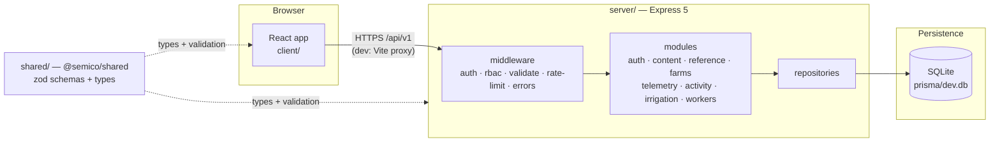
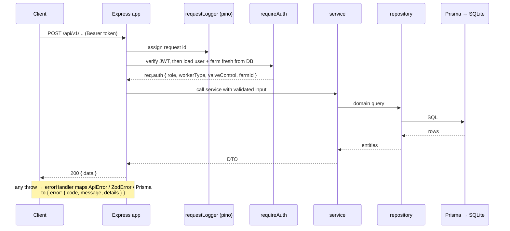

# Semico

Smart irrigation for Algerian farms — soil-moisture monitoring, automated watering, and
measurable water savings. Bilingual (English / العربية with full RTL), priced in DZD, built for
Algerian conditions.

This repository is a monorepo containing the web client, the API, and the domain contracts they
share.

---

## Layout

| Workspace | What it is | Stack |
|---|---|---|
| `client/` | The web app — marketing site and the authenticated farm dashboard | React 18, Vite 6, Tailwind 4, react-router 7, TanStack Query |
| `server/` | The REST API | Node 20+, Express 5, Prisma, SQLite |
| `shared/` | `@semico/shared` — zod schemas and inferred types used by both sides | TypeScript |

`docs/specs/` holds the original design documents. `guidelines/` is the Figma template.

### Why a shared workspace

`shared/` is the single source of truth for the domain. The server imports the zod schemas for
runtime request validation; the client imports the inferred types and reuses the same schemas for
form validation. Because the schemas **are** the types, a validation rule and its TypeScript shape
cannot drift apart. Neither side may import from the other.

---

## Architecture



In development the client proxies `/api` to the API, so the browser sees a single origin. That is
what allows the refresh token to live in an httpOnly `SameSite=Lax` cookie without needing CORS or
`SameSite=None`.

## Request lifecycle



The important detail is in `requireAuth`: the access token carries only the user id and role, and
the rest of the authorization context is re-read from the database on **every** request. That is
what makes revoking a worker's valve permission take effect immediately rather than whenever their
token happens to expire.

---

## Getting started

Requires Node 20+ and npm 10+ (npm workspaces).

```bash
npm install                     # installs all three workspaces
cp server/.env.example server/.env
npm run db:migrate              # create the SQLite schema
npm run db:seed                 # demo farm, content, 58 wilayas
npm run dev                     # API on :4000, client on :5173
```

The seed creates a demo farm you can sign in with:

| Role | Email | Password | Notes |
|---|---|---|---|
| Farm owner | `owner@semico.dz` | `Semico2026!` | full access, sees the owner code |
| Operator | `youssef@ferme.dz` | `Semico2026!` | valve control granted |
| Observer | `fatima@ferme.dz` | `Semico2026!` | read-only |

The demo farm's owner code is `SEMI-CO26` — a worker signs up with it to join an existing farm.
**These are demo credentials; change them before any real deployment.**

## Scripts

| Command | Does |
|---|---|
| `npm run dev` | API and client together |
| `npm run build` | Typecheck `shared`, then build `server` and `client` |
| `npm run typecheck` | `tsc --noEmit` across all workspaces |
| `npm run lint` | ESLint across all workspaces |
| `npm run test` | API test suite — 91 cases (vitest + supertest) |
| `npm run db:migrate` | Create/apply a Prisma migration |
| `npm run db:seed` | Seed demo data |
| `npm run db:studio` | Browse the database |
| `npm run db:reset` | Drop, re-migrate and re-seed |

Continuous integration runs typecheck, lint, tests and both builds (`.github/workflows/ci.yml`).

## Conventions

- **Layering.** `routes → controller → service → repository → Prisma`. Controllers never touch
  Prisma; repositories never throw HTTP errors. One module per feature, always the same file names.
- **Validation** happens at the controller boundary using the shared schemas, so request payloads
  are fully typed without casting.
- **Bilingual content** uses explicit `*En` / `*Ar` columns. Responses carry both, and the client
  picks one — so switching language never refetches.
- **Audit trail.** Permission changes and valve actions write an `AuditLog` row inside the same
  transaction as the state change, so the trail cannot drift from reality.

See [`client/README.md`](client/README.md) and [`server/README.md`](server/README.md) for the
details of each side.
