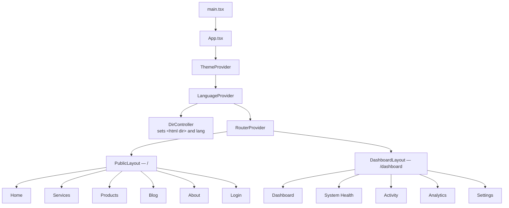
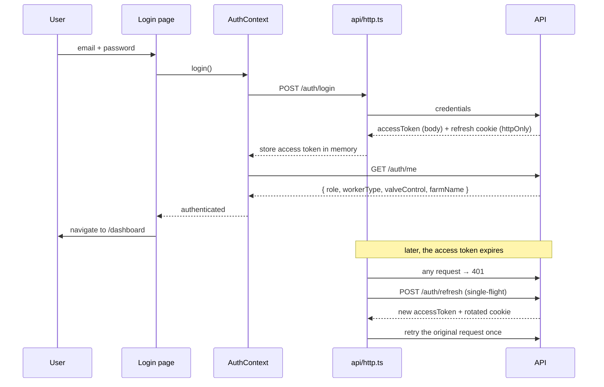

# `@semico/client`

The Semico web app — a public marketing site and an authenticated farm dashboard.

React 18 · Vite 6 · Tailwind 4 · react-router 7 · TanStack Query.

---

## Running it

```bash
npm run dev        # from the repo root, or in this workspace
```

Vite serves on **:5173** and proxies `/api` to the API on **:4000**, so the browser only ever sees
one origin in development. That is deliberate: it lets the refresh token live in an httpOnly
`SameSite=Lax` cookie without CORS or `SameSite=None`.

| Script | Does |
|---|---|
| `dev` | Vite dev server with HMR |
| `build` | Production bundle to `dist/` |
| `preview` | Serve the built bundle |
| `typecheck` | `tsc --noEmit` |

## Environment

| Variable | Default | Notes |
|---|---|---|
| `VITE_API_URL` | `/api/v1` | Base path for API calls. **Must include the version segment** — the server mounts under `/api/v1` and the dev proxy forwards `/api` verbatim without rewriting |
| `VITE_API_PROXY_TARGET` | `http://localhost:4000` | Where the dev proxy points |

---

## Structure

```
src/
├── main.tsx                    mounts App
├── api/                        one module per resource + the query-key factory
│   ├── http.ts                 ← actually lib/api/http.ts: envelope, tokens, 401 retry
│   ├── queryKeys.ts            cache-key factory, invalidated by prefix
│   └── auth.ts  farm.ts  telemetry.ts  activity.ts  irrigation.ts
│       analytics.ts  workers.ts  bookings.ts  content.ts  profile.ts
├── features/                   one folder per feature; mirrors server/src/modules
│   ├── auth/                   AuthContext + RequireAuth
│   ├── activity/  analytics/  content/  dashboard/  settings/  systemHealth/  workers/
├── lib/                        api/http.ts, api/queryClient.ts, time.ts, localized.ts
├── app/
│   ├── App.tsx                 provider tree
│   ├── routes.tsx              route table, all pages lazily loaded
│   ├── components/
│   │   ├── pages/              the 11 route components
│   │   ├── PublicLayout.tsx    navbar + footer shell
│   │   ├── DashboardLayout.tsx sidebar + header shell
│   │   ├── RouteFallback.tsx   suspense fallback
│   │   ├── Navbar.tsx  Footer.tsx  SemicoLogo.tsx  LanguageSwitcher.tsx
│   │   ├── SvgLineChart.tsx  LivingWaveGauge.tsx
│   │   └── ConsultationBooking.tsx
│   ├── contexts/
│   │   ├── LanguageContext.tsx  en/ar + RTL, persisted to localStorage
│   │   └── ThemeContext.tsx     light/dark/system; exposes the active palette
│   ├── hooks/                  useTokens, useLocalized, useDebounced, useChartWidth
│   ├── i18n/translations.ts    UI chrome only, English + Arabic
│   └── theme/tokens.ts         the single source of truth for colour
├── assets/                     logo and other bundled images
└── styles/                     Tailwind entry + fonts
```

`features/<name>/` deliberately mirrors `server/src/modules/<name>/`, so a change to a feature
touches one folder on each side with the same name.

## Provider and routing tree



## Internationalisation

Two locales, English and Arabic, both fully translated. `LanguageContext` exposes
`{ lang, setLang, t, isRTL, font }`; `isRTL` drives `dir="rtl"` on `<html>` and swaps the font
family to Noto Sans Arabic. `styles/index.css` keeps numerals LTR inside RTL contexts so data
values never read backwards.

Content that comes from the API is returned in **both** languages as a `{ en, ar }` pair, so the
language toggle repaints instantly without refetching. UI chrome stays in `i18n/translations.ts`.

## Theming

`theme/tokens.ts` is the single source of truth for the light and dark palettes. Pages read it
through `useTokens()` rather than declaring their own colour objects — the `Tokens` interface is
exhaustive, so a missing key is a build error instead of a silently transparent element.

Brand palette: Semico Green `#00A859` (primary), Smart Blue `#0077B6` (secondary), Energy Orange
`#FF6B35` (warnings), borders `#EAECF0`. Fonts: Inter (400/500), JetBrains Mono for all data
values, Noto Sans Arabic for Arabic.

Every page and the dashboard layout read this palette. The app originally had **seven separate
inline copies** of it, so a colour change meant seven edits and a missed one failed silently —
that is what the `Tokens` interface exists to prevent. `About` is the one exception: it spreads the
shared tokens and overrides six values, because its light-mode body text is deliberately darker
(`#4A4A4A`) than the app-wide muted tone.

## Sign-in flow



The access token is held **in memory only** — never `localStorage` — so an XSS bug cannot read a
long-lived credential. The refresh token is the httpOnly cookie, which JavaScript cannot see.

## Data fetching

TanStack Query, with one module per resource under `src/api/`. Query keys are namespaced
(`['telemetry','latest']`, `['activity','feed',{type}]`) so mutations can invalidate by prefix.

**Invalidating everything an action touched is the part that is easy to get wrong.** Opening a valve
writes an irrigation event, moves the valve *and* appends a farmer-facing activity row — so
`useIrrigate` invalidates telemetry, activity, irrigation and analytics. Refreshing only the
telemetry would leave the Activity page showing a history that does not include the thing the user
just did.

`api.getPage()` is used for list endpoints because it preserves the server's pagination `meta`;
`api.get()` would silently drop it.

## Conventions

- **Never declare a palette inline.** Use `useTokens()`.
- **Never hard-code domain data.** Prices, posts, products and sensor values come from the API; only
  chrome belongs in `i18n/translations.ts`.
- **Add user-facing strings to both locales.** `translations.ts` is cast
  `as unknown as TranslationSet`, so the compiler will not catch a key missing from `ar`.
- Prefer logical CSS properties (`ms-`/`me-`, `ps-`/`pe-`, `borderInlineEnd`) so RTL mirrors for
  free rather than needing per-component branching.
