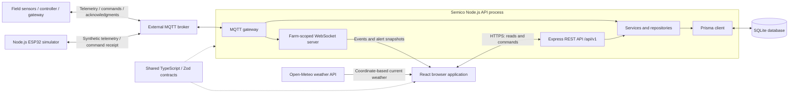

# Semico V5: Platform Architecture

## 1. Project purpose and architectural approach

Semico is a smart-irrigation web platform for Algerian farms. It combines farm monitoring,
irrigation-command management, geographic visualization, technical diagnostics, public marketing
content, and platform-level SaaS administration. Its objective is to connect field observations
with informed irrigation decisions while separating farm operations from platform governance.

The software is a **layered modular monolith**, not a microservices system. One Node.js API
process hosts the REST API, MQTT gateway, and browser WebSocket server. An external MQTT broker
connects this process to reporting devices or the supplied device simulator. This design keeps
deployment and transaction management manageable for a graduation-project implementation while
maintaining explicit module boundaries.

The repository is an npm-workspaces monorepo:

| Workspace | Responsibility                                                               | Main technologies                                                                       |
| --------- | ---------------------------------------------------------------------------- | --------------------------------------------------------------------------------------- |
| `client/` | Browser application, public website, farm dashboard, admin portal            | React 18, TypeScript, Vite 6, Tailwind CSS 4, React Router 7, TanStack Query 5, Leaflet |
| `server/` | REST endpoints, authorization, business rules, persistence, device messaging | Node.js, Express 5, TypeScript, Prisma 6, SQLite, MQTT.js, native WebSocket server      |
| `shared/` | Common contracts and runtime validation schemas                              | TypeScript, Zod                                                                         |

## 2. System topology

The field hardware is the intended integration boundary. This repository includes the web/API
software and a Node.js ESP32 simulator, not production ESP32/LoRa firmware. Actual field radio,
sensor calibration, power autonomy, and physical valve operation require separate hardware
implementation and validation.

## 3. Browser application

The React application has three route areas:

- Public routes provide the home page, services/pricing, products, blog, company information,
  authentication, sales enquiries, and consultation booking.
- `/dashboard` provides authenticated farm monitoring, System Health, Activity, Analytics,
  Settings, and Technical Diagnostics.
- `/admin` uses a dedicated layout for platform statistics, pricing management, bilingual blog
  editing, farm oversight, and user-account oversight.

Pages are loaded lazily. Shared providers manage theme, English/Arabic language selection,
authentication, query caching, routing, and notifications. Arabic interfaces support right-to-left
layout; database-backed translatable content uses explicit English/Arabic pairs.

TanStack Query manages server state, cache invalidation, loading/error states, and refetching.
Private admin cache keys include the administrator identity and page number and are discarded
after unmount. Successful CMS and oversight mutations invalidate affected lists and related
public, session, or farm queries.

Leaflet displays farm boundaries, zones, moisture information, and sensor/connectivity data.
Map viewport state is isolated by farm and shared between relevant dashboard pages. Configured
layout slots are not counted as physically reporting devices.

## 4. API layers and request lifecycle

Feature modules follow a controller/service/repository organization:

1. Middleware establishes request logging, security headers, CORS, parsing, rate limits, and
   authentication/authorization.
2. Controllers validate body, query, and path inputs with shared Zod schemas.
3. Services apply business rules and coordinate transactions and external messaging.
4. Repositories issue farm-scoped or explicitly platform-scoped Prisma queries.
5. Mappers produce selected, bilingual, serializable DTOs rather than exposing database rows.

Successful responses use a common `data` envelope, with `meta` for pagination. Errors use stable
codes, messages, and optional field details. Central error handling translates validation,
authorization, missing-resource, conflict, and database errors consistently.

Modules cover authentication, profiles, farms, workers, telemetry, activity, irrigation,
analytics, audit, reference data, content, leads, bookings, realtime messaging, and administration.
The Express app factory is separate from process startup, allowing API tests without starting
the production MQTT gateway. Liveness/readiness endpoints and graceful shutdown support operation.

## 5. Relational data model

SQLite provides a portable local relational database accessed through Prisma. Versioned
migrations evolve the schema; a non-destructive standalone seed provisions the first platform
administrator, while the separate demo seed resets demonstration data.

| Domain                     | Main entities                                                                                   |
| -------------------------- | ----------------------------------------------------------------------------------------------- |
| Identity and sessions      | `User`, `RefreshToken`, `Experience`, `Education`                                               |
| Farm organization          | `Farm`, `FarmSettings`, `Zone`, `Sensor`, `Wilaya`                                              |
| Operations and diagnostics | `Telemetry`, `DeviceStatus`, `SystemComponent`, `ErrorLog`, `IrrigationCommand`                 |
| Traceability               | `ActivityLog`, `AuditLog`                                                                       |
| Public content and pricing | `PricingPlan`, `BlogPost`, `Product`, `TeamMember`, `Stat`, `Testimonial`, legacy `ServicePlan` |
| Commercial enquiries       | `Lead`, `Booking`, `BookingBlock`                                                               |

Owners are linked through `Farm.ownerId`; workers through `User.farmId`. Owners may hold up to
three farms, enforced by the application. Operational tables include `farmId`, and composite
indexes support farm/time-range queries. UUID MQTT message IDs and a farm/message uniqueness
constraint prevent duplicate telemetry storage under QoS 1 redelivery.

The current schema stores role/status values as validated strings and structured extras as
JSON-encoded strings. Bilingual fields use explicit `*En`/`*Ar` columns. Pricing features are
validated bilingual pairs stored in `PricingPlan.featuresJson` and parsed in API responses.

## 6. Authentication, RBAC, and tenant isolation

Passwords are hashed with Argon2id. Short-lived JWT access tokens are held in browser memory;
their default lifetime is 15 minutes. Opaque refresh tokens use HTTP-only cookies and default to
30 days. Only refresh-token hashes are stored, with rotation, family tracking, and reuse detection.
Production deployment must configure HTTPS and secure cookies appropriately.

The API verifies JWT identity, then reloads the user's role, status, permissions, farm membership,
and selected farm status from the database on every authenticated request. Authorization does
not rely on stale role or permission values in the browser or token.

| Role/capability       | Responsibilities                                                                                                       |
| --------------------- | ---------------------------------------------------------------------------------------------------------------------- |
| `SUPER_ADMIN`         | Dedicated platform portal, global metrics, CMS, farms/users oversight; no inherited farm membership or valve authority |
| `OWNER`               | Own-farm operations, settings, worker management, valve control, analytics/export, diagnostics                         |
| `WORKER` / `ENGINEER` | Farm observation, analysis/export, and technical diagnostics; no valve control                                         |
| `WORKER` / `OPERATOR` | Farm observation; manual valve actions only while the owner-granted `valveControl` capability is active                |

Every `/api/v1/admin/*` endpoint requires an active super admin; owners and workers receive 403.
An owner's `X-Farm-Id` selection must identify an owned farm. Workers cannot select another farm.
Farm-scoped repositories and resource checks prevent cross-tenant access, including through
known resource IDs. Public registration cannot create a super administrator.

Farm suspension blocks farm-scoped access and new worker signups, while leaving user profiles,
other owned active farms, historical data, and physical device state intact. Account disabling
uses an additional platform lock that tenant owners cannot override. It revokes refresh sessions,
pending realtime tickets, and live sockets. Enabling does not change roles, farm membership,
or valve grants. Self-disabling is rejected, and status transactions protect the last active admin.
Administrative status changes and their audit records are written transactionally.

## 7. Device telemetry and browser realtime flow

Devices publish validated readings to `semico/v1/devices/{deviceId}/telemetry`. The gateway
resolves device IDs through a server-owned registry, checks payload ranges and farm/zone
associations, persists measurements, updates diagnostic state, and publishes browser events.
Broker authentication/topic ACLs are an essential deployment boundary; device IDs alone are not
a complete device-authentication system. Production MQTT URLs must use `mqtts://`.

Browsers obtain short-lived, single-use tickets bound to an authorized user/farm before opening
WebSockets. Telemetry/connectivity events invalidate related REST query caches, while alert
events replace the cached alert snapshot directly. Reconnect logic reacquires tickets; alert
snapshots replay on reconnect. REST refetching/polling remains available as a fallback.

Handshake and periodic authorization checks read current account/farm state. Explicit admin
revocations close affected sockets and invalidate pending tickets immediately in the running
API process. Ticket storage, alert snapshots, and the 120-second active-device tracker are
process-local; historical telemetry remains in the database after restart.

## 8. Irrigation command lifecycle

A permitted owner or operator sends a validated REST command. The API records an
`IrrigationCommand` and associated traceability information, then routes the command to the
registered controller's `commands/valve` topic. Acknowledgments arrive on `acks/valve` and must
match the command ID, controller, farm, and zone.

- `RECEIVED` records receipt but leaves the command pending and does not change valve state.
- A valid `EXECUTED` acknowledgment completes the command and updates the confirmed valve state.
- `FAILED` records failure without pretending the valve changed state.
- Missing receipt acknowledgments fail at a bounded timeout, 30 seconds by default.

Duplicate/mismatched messages do not cause repeated or unauthorized state changes. Importantly,
without a configured MQTT command transport, the application uses simulated immediate execution.
Such execution is a software demonstration, not proof of a physical valve movement.

## 9. SaaS administration and content management

The global dashboard reports total farms/users, unique recently active MQTT devices, and the five
newest farm signups. Farm/user totals include all statuses. MQTT activity is observed traffic,
not a count inferred from seeded online flags.

Pricing management supports creation, editing, activation/deactivation, and deletion. Public
services renders active database plans, currencies, and bilingual features without hardcoded
price fallbacks. Blog management supports bilingual titles, excerpts, and bodies, with drafts
hidden from public index/detail APIs until published.

Farm and user oversight use paginated, private, selected-field responses. Status inputs cannot
change roles, passwords, ownership, or memberships by mass assignment. The UI confirms potentially
disruptive actions and prevents accidental self-disabling.

Pricing is currently a catalogue/CMS feature. Automated subscriptions, invoicing, payment
processing, and billing-triggered suspension are not implemented and should be described as
future work rather than existing SaaS functionality.

## 10. Analytics, evidence, and limitations

Analytics uses persisted farm telemetry and irrigation history for charts, diagnostics, and CSV
exports. Current weather is fetched from Open-Meteo only for farms with configured coordinates.
The repository also retains a tested deterministic demo-plot engine for soil/moisture, irrigation,
alerts, and savings scenarios; these calculations and simulator readings are synthetic/modelled.

Water savings and rainfall-adjusted comparisons are estimates rather than measured comparisons
against an instrumented manual-irrigation baseline. Business targets such as 50% water savings or
35% productivity improvement require controlled field studies. Software tests, simulated command
receipt, and messaging demonstrations do not establish those agricultural outcomes.

SQLite and process-local realtime state are suitable for this implementation's single-API
deployment, but horizontal scaling would require shared ticket/revocation/alert state and an
appropriate database/deployment strategy. Other future work includes production firmware,
sensor calibration, stronger device provisioning, automated billing, email delivery, and
live-browser accessibility/usability testing.

## 11. Validation and reproducibility

The final V5 validation run passed **828 tests: 515 server and 313 client tests**, together with
all-workspace typecheck, targeted lint/formatting checks, and server/client production builds.
Coverage includes real Express/SQLite integration, RBAC matrices, farm isolation, token edge
cases, CMS, oversight, audit consistency, MQTT redelivery, command receipts, WebSocket revocation,
client state/cache behavior, bilingual UI, and simulation algorithms.

API tests use a disposable SQLite database separate from development data. Client tests combine
pure-function testing, server-rendered component checks, and static accessibility/bundle audits;
they are not a substitute for full browser or field-hardware validation. GitHub Actions defines
installation, typecheck, lint, tests, and builds on Node.js 22.

For a reproducible installation, configure the ignored server environment, apply migrations,
generate Prisma, provision the administrator through `db:seed:admin`, and start the API/client.
Never include actual environment secrets, administrator passwords, or database files in Git.
The MQTT demonstration procedure is documented in `docs/realtime-mqtt.md`; business-evidence
qualifications are documented in `docs/BMC-ALIGNMENT.md`.

## Source map

| Architectural element        | Source location                                                                              |
| ---------------------------- | -------------------------------------------------------------------------------------------- |
| Browser providers/routes     | `client/src/app/App.tsx`, `client/src/app/routes.tsx`                                        |
| REST bootstrap/middleware    | `server/src/index.ts`, `server/src/app.ts`, `server/src/routes/index.ts`                     |
| Authorization context        | `server/src/middleware/auth.ts`, `server/src/middleware/rbac.ts`, `server/src/types/auth.ts` |
| Database model/migrations    | `server/prisma/schema.prisma`, `server/prisma/migrations/`                                   |
| Device ingestion/commands    | `server/src/modules/telemetry/mqttGateway.ts`, `server/src/modules/irrigation/`              |
| Realtime transport/cache     | `server/src/modules/realtime/`, `client/src/features/realtime/`                              |
| Platform administration      | `server/src/modules/admin/`, `client/src/features/admin/`                                    |
| Mapping/analytics/simulation | `client/src/features/map/`, `server/src/modules/analytics/`, `client/src/features/demoPlot/` |
| Hardware-free simulator      | `server/scripts/esp32-simulator.ts`                                                          |
| Quality checks               | `server/tests/`, `client/tests/`, `.github/workflows/ci.yml`                                 |
