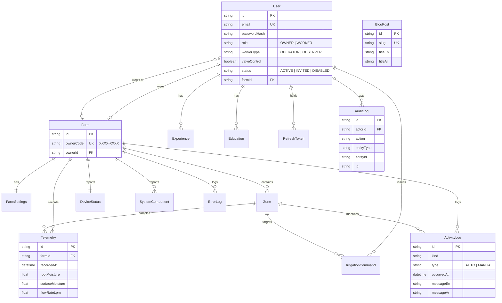

# `@semico/server`

The Semico REST API — Express 5, Prisma and SQLite, in TypeScript.

---

## Running it

```bash
cp .env.example .env      # then edit: at minimum, the two secrets
npm run db:migrate        # from the repo root, or `npm run db:migrate` in this workspace
npm run db:seed
npm run dev               # tsx watch on http://localhost:4000
```

| Script | Does |
|---|---|
| `dev` | `tsx watch src/index.ts` |
| `build` | Bundle to `dist/` with tsup |
| `start` | Run the built output |
| `typecheck` | `tsc --noEmit` |
| `test` / `test:watch` | vitest + supertest |
| `db:migrate` / `db:deploy` | Create a migration / apply migrations in production |
| `db:seed` | Seed demo data |
| `db:seed:admin` | Provision a super admin without replacing existing data |
| `db:reset` | Drop, re-migrate, re-seed |
| `db:studio` | Prisma Studio |

Health endpoints: `GET /healthz` (liveness, never touches the database) and `GET /readyz`
(readiness, checks the database).

## First platform administrator

Apply migrations with `npm run db:deploy`, then set `SUPER_ADMIN_PASSWORD` in `server/.env`
(8–200 characters) and run `npm run db:seed:admin` from the repository root or this workspace.
`SUPER_ADMIN_EMAIL` defaults to `admin@semico.dz` and `SUPER_ADMIN_NAME` to `Platform Admin`.
The script is `prisma/seed-super-admin.ts`; it creates an active `SUPER_ADMIN` with no farm,
worker type, or valve permission. Re-running preserves the existing password and account status.
It refuses to promote an existing owner or worker that uses the same email.

Public signup accepts only `OWNER` and `WORKER`. All `/api/v1/admin/*` requests require an active
`SUPER_ADMIN`; owners receive 403. Farm roles and capabilities remain separate from platform access.
The dedicated portal is at `/admin/dashboard`; `/admin` redirects there. Other signed-in roles
are redirected to `/dashboard`, while super admins are directed to their portal after login.

`GET /api/v1/admin/stats` returns `totalFarms`, `totalUsers`, `totalActiveMqttDevices`, and the five
newest `recentFarms` with owner name/email. Farm and user totals include every status.
Active MQTT devices are unique registered devices whose valid telemetry or valve acknowledgement
was accepted within the last 120 seconds. Activity is observed in the running API process and
starts at zero after a restart until devices report again. It is not inferred from demo device
flags. The dashboard refreshes every 30 seconds and supports English and Arabic.

## Content & pricing management

The `/admin/pricing` and `/admin/blog` screens are restricted to active super admins. They provide
English/Arabic editors, paginated lists, validation, and confirmation before permanent deletion.
Pricing status controls visibility on `/services`; blog posts default to private drafts.

| Endpoint | Behavior |
|---|---|
| `GET /api/v1/admin/pricing` | All plans, including inactive plans |
| `GET /api/v1/admin/pricing/:id` | One plan |
| `POST /api/v1/admin/pricing` | Create a plan |
| `PATCH /api/v1/admin/pricing/:id` | Edit a plan or toggle `isActive` |
| `DELETE /api/v1/admin/pricing/:id` | Permanently delete a plan |
| `GET /api/v1/admin/blog` | All published posts and drafts, including editable bodies |
| `GET /api/v1/admin/blog/:id` | One post, including drafts |
| `POST /api/v1/admin/blog` | Create a bilingual post; defaults to a draft |
| `PATCH /api/v1/admin/blog/:id` | Edit or publish/unpublish a post |
| `DELETE /api/v1/admin/blog/:id` | Permanently delete a post |
| `GET /api/v1/content/pricing-plans` | Public active plans, ordered by price |

Admin list responses use the usual `data`/`meta` envelope. `page` defaults to 1 and `pageSize` to 20
(maximum 100). Admin reads are private and non-cacheable. Unknown IDs return 404; duplicate blog
slugs return 409. Owners and workers cannot access any of these admin endpoints.

Plan inputs use `nameEn`, `nameAr`, a nonnegative numeric `price`, a three-letter `currency`
(default `DZD`), `features: [{ en, ar }]` (default empty), and `isActive` (default true).
Feature pairs are validated and stored in `PricingPlan.featuresJson`; responses expose parsed
features and `name: { en, ar }`. The services page renders these values directly, including free
plans, and retains a separate consultation action for tailored solutions.

Blog inputs require `slug`, `titleEn`, `titleAr`, `bodyEn`, and `bodyAr`. Optional fields include
`excerptEn`, `excerptAr`, `category` (`TECHNOLOGY`/`GUIDES`), ISO `publishedAt`, `published`, an
HTTP(S) `coverImageUrl`, and nonnegative integer `sortOrder`. The UI edits publish dates in UTC.
Public blog reads continue to exclude drafts, even when accessed directly by slug.

The demo seed now populates two active pricing plans. It remains a destructive demo reset; use
the CMS to add production plans without resetting data. No additional migration beyond Phase 1
is needed. Legacy `ServicePlan` APIs remain available for compatibility, but `/services` no longer
uses them. CMS mutations invalidate both admin lists and affected public query caches.

## Farms & users oversight

Active super admins manage all farms at `/admin/farms` and all accounts at `/admin/users`.
Both lists are paginated (`page=1`, `pageSize=20`, maximum 100), private/non-cacheable, and return
only selected fields: no password hashes, refresh tokens, or farm join codes.

| Endpoint | Behavior |
|---|---|
| `GET /api/v1/admin/farms` | Every farm, status, owner name/email, and worker count |
| `PATCH /api/v1/admin/farms/:id/status` | Set `status` to `ACTIVE` or `SUSPENDED` |
| `GET /api/v1/admin/users` | Every account, role/status, worker type, and farm associations |
| `PATCH /api/v1/admin/users/:id/status` | Set `status` to `ACTIVE` or `DISABLED` |

Suspension blocks farm-scoped reads, writes, exports, ticket issuance, and new worker signups.
Owners can still access their profiles, list their farms, and select another active farm.
Resuming restores access without deleting data or changing device/valve state. Device telemetry
collection is not stopped by an access suspension.

Disabling an account sets its platform-level lock and revokes refresh sessions, pending realtime
tickets, and live sockets. Owners cannot override the lock by reactivating an invited/disabled
worker; offboarding preserves it. Login and REST/realtime authorization check the lock as well as
the legacy status. Enabling clears the lock without changing roles, membership, or valve grants;
it may also activate a pending invitation. Account disables do not automatically suspend farms
or other farm members. Existing revoked refresh tokens remain revoked after re-enabling.

Status changes are audited transactionally as `ADMIN_FARM_STATUS_CHANGED` and
`ADMIN_USER_STATUS_CHANGED`. The current admin cannot disable their own account, and status
transactions preserve at least one active super admin. Both UI actions require confirmation.

Before launching this version, apply all pending migrations with
`npm --workspace server run db:deploy` from the repository root. The Phase 4 migration adds
`User.platformDisabled` with a false default, preserving existing accounts and tenant-managed
disables. No production/development database reset is required. After dependency installation or
schema changes, generate the client with `npm --workspace server run db:generate`.

## Environment

Validated with zod at boot — a missing or malformed value fails the process immediately with a
readable message rather than surfacing as an `undefined` deep inside a request.

| Variable | Default | Notes |
|---|---|---|
| `NODE_ENV` | `development` | |
| `PORT` | `4000` | |
| `LOG_LEVEL` | `info` | pino level |
| `CORS_ORIGIN` | `http://localhost:5173` | comma-separated list |
| `DATABASE_URL` | — | `file:./dev.db` |
| `JWT_ACCESS_SECRET` | — | ≥32 chars; `openssl rand -base64 48` |
| `REFRESH_TOKEN_PEPPER` | — | ≥32 chars; **must differ** from the access secret |
| `ACCESS_TOKEN_TTL_SECONDS` | `900` | 15 minutes |
| `REFRESH_TOKEN_TTL_SECONDS` | `2592000` | 30 days |
| `COOKIE_SECURE` | `false` | set `true` only behind HTTPS |
| `COOKIE_DOMAIN` | unset | |
| `MQTT_URL` | unset | Optional; `mqtts://` required in production; unset disables the gateway |
| `MQTT_USERNAME` / `MQTT_PASSWORD` | unset | Optional paired server MQTT credentials (telemetry/ACK subscribe, command publish) |
| `MQTT_TOPIC_PREFIX` | `semico/v1/devices` | Telemetry/ACK subscriptions and valve-command topics use this prefix |
| `MQTT_DEVICE_REGISTRY` | `{}` | JSON device ID → server-owned farm/zone mapping; required when MQTT_URL is set |

---

## Layout

```
src/
├── index.ts          bootstrap: env → app → listen → graceful shutdown
├── app.ts            Express app factory (no listen → supertest can mount it directly)
├── config/env.ts     zod-validated, frozen config
├── db/prisma.ts      PrismaClient singleton + ping helpers
├── lib/              ApiError, response envelope, jwt, password, cookies, audit, validation
├── middleware/       auth, rbac, error handler, 404, request logger, rate limits
├── modules/          one folder per feature
│   └── <feature>/
│       ├── <feature>.routes.ts        paths + middleware only
│       ├── <feature>.controller.ts    HTTP ↔ domain; owns status codes and cookies
│       ├── <feature>.service.ts       rules, permissions, transactions
│       ├── <feature>.repository.ts    the only place Prisma appears
│       └── <feature>.mapper.ts        row → DTO (bilingual pairs, derived fields)
├── routes/index.ts   mounts every module under /api/v1
└── types/            express request augmentation, AuthContext + capability helpers
```

**The layering rule.** Routes never contain logic. Controllers never import Prisma. Services never
touch `req`/`res`. Repositories never throw `ApiError`. This is what keeps permissions and audit
writes in one predictable place per feature instead of scattered across handlers.

## Data model



Two schema constraints are worth knowing before you edit `schema.prisma`:

1. **SQLite has no native `enum` in Prisma.** Every status field is a `String` whose allowed values
   live in `shared/src/enums.ts` and are validated by zod at the edges. Writing `enum` in the schema
   will fail `prisma migrate`.
2. **SQLite has no `Json` scalar.** Structured extras (`AuditLog.metadata`, `ActivityLog.params`)
   are JSON-encoded strings.

Translatable content uses explicit `titleEn` / `titleAr` column pairs rather than JSON — queryable,
type-safe, and portable if the project ever moves off SQLite.

## API

All routes are under `/api/v1`. 🔓 public · 🔐 signed in · 👑 owner · 🎛 owner or granted operator

| Method | Path | Auth | Notes |
|---|---|---|---|
| GET | `/health` | 🔓 | versioned liveness |
| POST | `/auth/register` | 🔓 | owner creates a farm, or worker joins by owner code |
| POST | `/auth/login` | 🔓 | also resolves an `INVITED` account to `ACTIVE` |
| POST | `/auth/refresh` | 🔓 | rotates; reuse revokes the whole token family |
| POST | `/auth/logout` | 🔐 | revokes the refresh token |
| GET | `/auth/me` | 🔐 | |
| GET/PATCH | `/users/me` | 🔐 | own profile; email and role are not editable |
| POST/PATCH/DELETE | `/users/me/experience[/:id]` | 🔐 | |
| POST/PATCH/DELETE | `/users/me/education[/:id]` | 🔐 | |
| GET/PATCH | `/farms/me` | 🔐 / 👑 | |
| GET/PATCH | `/farms/me/settings` | 🔐 / 👑 | thresholds and preferences |
| POST | `/farms/me/owner-code/rotate` | 👑 | invalidates the old join code |
| GET | `/farms/me/zones` | 🔐 | |
| GET | `/farms/me/workers` | 👑 | |
| POST | `/farms/me/workers/invite` | 👑 | returns a one-time password |
| PATCH | `/farms/me/workers/:id` | 👑 | demoting an operator clears valve control |
| PATCH | `/farms/me/workers/:id/valve-control` | 👑 | audited |
| POST | `/farms/me/workers/:id/reset-password` | 👑 | returns a one-time password, revokes sessions |
| DELETE | `/farms/me/workers/:id` | 👑 | soft delete — detach + disable |
| GET | `/farms/me/telemetry/latest` · `/latest-per-zone` | 🔐 | |
| GET | `/farms/me/telemetry` | 🔐 | `?interval=day\|hour&range=7d` |
| GET | `/farms/me/device-status` | 🔐 | |
| GET | `/farms/me/system-health` · `/system-health/errors` | 🔐 | |
| GET | `/farms/me/activity` | 🔐 | paged; filter by type/kind/zone/date |
| GET | `/farms/me/activity/calendar` | 🔐 | day numbers that had irrigation |
| POST | `/farms/me/irrigation/irrigate` | 🎛 | writes command + valve + feed + audit atomically |
| POST | `/farms/me/irrigation/valve` | 🎛 | open/close |
| GET | `/farms/me/irrigation/commands` | 🔐 | |
| GET | `/farms/me/analytics/overview` · `/moisture` · `/flow` · `/heatmap` | 🔐 | |
| GET | `/farms/me/analytics/export` | 🔐 | CSV, not the JSON envelope |
| GET | `/farms/me/audit` | 👑 | security trail with actor, IP, user agent |
| GET | `/bookings/availability` | 🔓 | |
| POST | `/bookings` | 🔓 | rate-limited on the auth budget |
| GET | `/bookings` · PATCH `/bookings/:id` | 👑 | confirm or cancel |
| POST | `/leads` | 🔓 | lead-capture form, rate-limited on the auth budget |
| GET | `/leads` · PATCH `/leads/:id` | 👑 | sales pipeline; nothing is emailed, so this is where enquiries surface |
| GET | `/content/bundle` · `/blog` · `/blog/:slug` · `/products` · `/service-plans` · `/team` · `/stats` · `/testimonials` | 🔓 | bilingual |
| GET | `/reference/wilayas` | 🔓 | 58 rows |

Response envelope: `{ data, meta? }` on success, `{ error: { code, message, details? } }` on
failure. The client unwraps `data` and throws on `error`, so handlers never invent their own shape.
`code` is stable and machine-readable; the client branches on it to show translated copy.

## Authentication and permissions

**Two concepts, deliberately separate.**

- **Role** — `OWNER` or `WORKER`. Gates administration: workers, farm settings, the audit trail.
- **Capability** — valve control. Not a role. An `OPERATOR` holds it only while the owner has
  granted it; `OBSERVER`s never do.

**Tokens.** The access token is a 15-minute JWT carrying only `{ sub, role }`, held in memory by the
client. The refresh token is opaque and random, stored only as a hash, delivered as an httpOnly
`SameSite=Lax` cookie scoped to `/api/v1/auth`, and rotated on every use — presenting an
already-revoked one revokes the entire token family and forces a fresh sign-in.

**Why the JWT is deliberately thin.** `requireAuth` re-reads `workerType`, `valveControl`, `status`
and `farmId` from the database on every request. If those lived in the token, revoking an operator's
valve permission would not take effect until their token expired. Do not move them into the JWT to
save a query — that is a security regression, not an optimisation.

## Audit trail

Two tables record the same events for different audiences:

- `AuditLog` — security. Actor, IP, user agent. Owner-only, never bilingual.
- `ActivityLog` — the farmer-facing feed. Bilingual, farm-scoped, what the Activity page renders.

Both are written by `lib/audit.ts` and `service` code **inside the same `$transaction` as the state
change**, so a grant that rolls back cannot leave an audit row claiming it happened. Actions
recorded: `PERMISSION_GRANT`, `PERMISSION_REVOKE`, `VALVE_OPEN`, `VALVE_CLOSE`, `WORKER_INVITED`,
`WORKER_REMOVED`, `LOGIN`, `REFRESH_REUSE_DETECTED`.

## Adding an endpoint

1. Add or extend the zod schema in `shared/src/domain/`.
2. Write the repository method (Prisma only, always farm-scoped).
3. Write the service method (rules, permission checks, transactions, audit writes).
4. Write the controller (parse with the shared schema, call the service, shape the response).
5. Mount it in `<feature>.routes.ts`, then in `routes/index.ts`.
6. Add a supertest case in `tests/`.

## Testing

```bash
npm test
```

vitest + supertest against a real Express app and a throwaway SQLite file, so tests exercise the
middleware chain, validation and the database rather than mocks.

## Notes

- `argon2` is a native module. If it will not build on a target machine, `lib/password.ts` is the
  only file that needs to change to swap in pure-JS `bcryptjs`.
- The build uses `tsup` (esbuild) rather than raw `tsc`: Node ESM requires `.js` extensions on
  relative imports, and `tsc` will not rewrite them. `tsc` is still used for `--noEmit` typechecking.
- The seed data is demo data — mock workers, sensors and posts. It is not real farm data.
